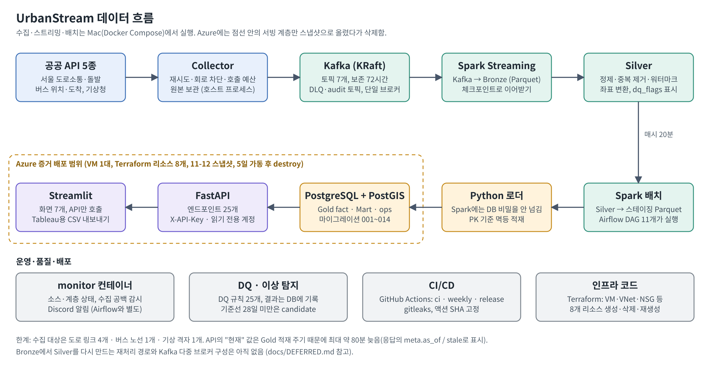
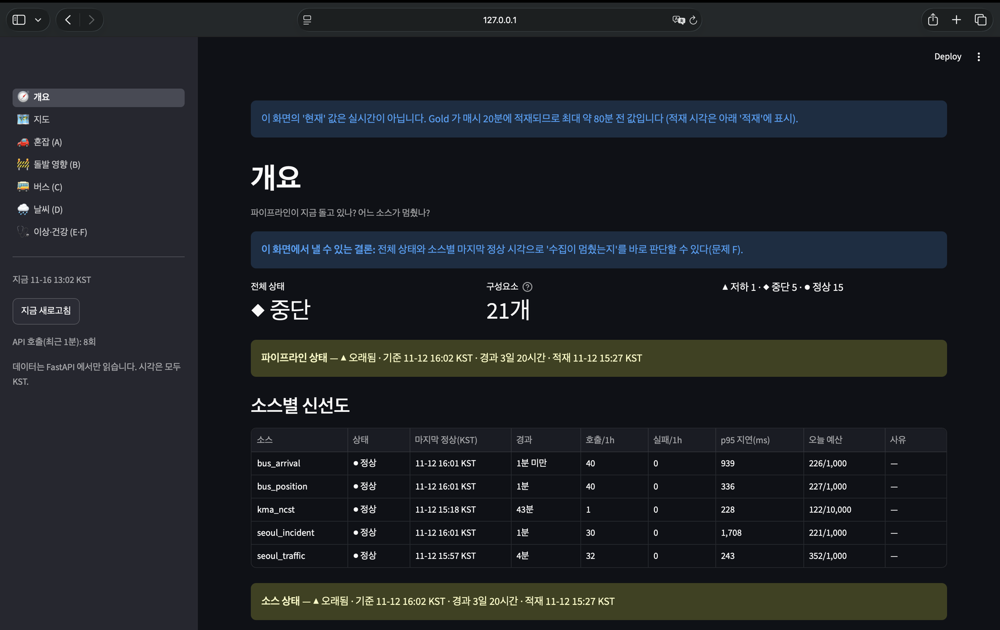
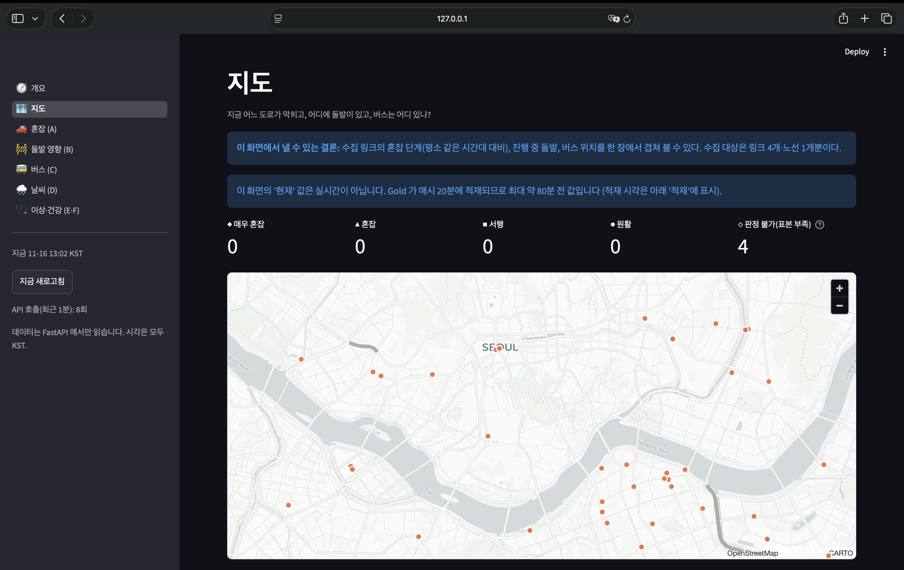
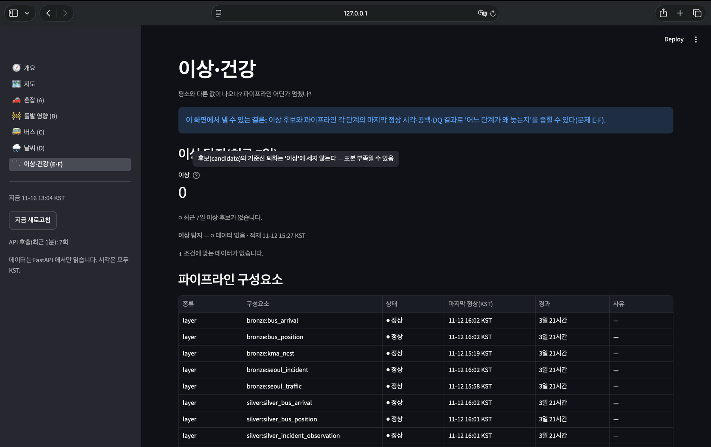

# UrbanStream

서울시가 공개하는 도로 소통·돌발·버스 위치·버스 도착 Open API와 기상청 초단기실황 API를 수집해,
Kafka와 Spark Structured Streaming을 거쳐 Bronze → Silver → Gold(PostgreSQL/PostGIS)로 적재하고,
FastAPI와 Streamlit 대시보드로 보여 주는 개인 데이터 엔지니어링 프로젝트입니다.
첫 번째 프로젝트인 Olist 이커머스 배치 파이프라인이 정적 데이터와 배치 처리에 머물렀던 점을 보완하려고 시작했습니다.

범위는 의도적으로 작습니다. 수집 대상은 도로 링크 4개, 버스 노선 1개(753번), 기상 격자 1개이고,
서울 전체 교통을 분석하는 시스템은 아닙니다. 대신 한 줄기 데이터가 수집부터 서빙까지 흐르는 과정과
그 사이에서 생기는 실패(API 오류, 중복, 지연, 프로세스 중단)를 어떻게 다뤘는지를 보여 주는 것이 목적입니다.

## 아키텍처



| 계층 | 하는 일 | 코드 |
|---|---|---|
| 수집 | API 호출, 재시도, 회로 차단, 일일 호출 예산, 원본 보관, 실패 건은 DLQ 토픽으로 | `collector/` |
| 전달 | Kafka(KRaft 단일 브로커) 토픽 7개, 호출 결과를 남기는 audit 토픽 | `config/topics.yaml` |
| Bronze | Kafka 메시지를 Parquet으로 보존(Spark Structured Streaming) | `streaming/bronze*.py` |
| Silver | 타입 변환, event time 워터마크, `dedup_key` 중복 제거, 좌표 변환, 이상값 표시 | `streaming/silver*.py` |
| Gold | Spark 배치가 스테이징 Parquet을 만들고 Python 로더가 PostgreSQL에 적재. Star Schema + 마트 | `batch/`, `sql/` |
| 오케스트레이션 | Airflow DAG 11개(Gold 적재, 혼잡 기준선, 돌발 영향, 날씨·교통, DQ 리포트, 이상 탐지 등) | `dags/` |
| 품질·감시 | DQ 규칙 24개(`config/dq_rules.yaml`), Silver 행 수 대조, 이상 탐지, 소스·계층 상태 감시, Discord 알림 | `src/urbanstream/{dq,monitor,notify}` |
| 서빙 | FastAPI 엔드포인트 25개, 대시보드 7개 화면, Tableau용 CSV | `api/`, `dashboard/` |
| 배포·검증 | GitHub Actions(ci·weekly·release), Terraform(Azure) | `.github/`, `infra/terraform/` |

## 설계에서 신경 쓴 부분

각 결정의 이유와 되돌리는 방법은 `docs/adr/`에 날짜와 함께 적어 두었습니다.

- **원본을 남기고 정제는 다시 할 수 있게.** Bronze는 Kafka 메시지를 그대로 Parquet으로 보존하고, 정제 규칙은 Silver에 둡니다. 결측이나 0값은 고쳐 넣지 않고 `dq_flags`로 표시만 합니다(ADR-0005, 0007). Delta Lake는 이번 범위에서 보류했습니다(ADR-0006).
- **늦게 오거나 두 번 오는 데이터.** 소스별 event time 기준 워터마크(도로·버스 10분, 기상 3시간)와 `dedup_key`로 중복을 걸러내고, Gold fact는 같은 키를 PK로 둬서 같은 구간을 다시 적재해도 행이 늘지 않습니다(ADR-0001, 0007, 0008).
- **Spark에 DB 비밀을 넘기지 않기.** Spark는 스테이징 Parquet까지만 만들고, DB 적재는 별도 로더가 맡습니다(ADR-0008).
- **API가 유일한 데이터 입구.** Streamlit은 DB에 연결하지 않고 FastAPI만 호출하며, API는 읽기 전용 DB 계정을 씁니다. 이 규칙은 시험이 import를 검사해서 막습니다(ADR-0011, 0012).
- **감시는 Airflow 밖에서.** Airflow가 멈추면 Airflow 안의 감시도 같이 멈추므로, monitor를 별도 컨테이너로 두었습니다(ADR-0010).
- **모르는 것은 모른다고 표시.** 표본이 부족하면 혼잡 단계를 "원활"이 아니라 `판정 불가`로 두고, API 응답에는 `as_of`, `age_sec`, `stale`을 붙입니다(ADR-0012).

## 화면

Azure에 올렸던 서빙 계층에서 캡처한 화면입니다(11-12 시점 스냅샷이라 실시간 값이 아닙니다).

<table>
<tr>
<td><br>개요</td>
<td><br>지도</td>
<td><br>이상·파이프라인 상태</td>
</tr>
</table>

## 규모와 측정값

2026-11-03 ~ 11-18 동안 Mac에서 돌린 결과입니다. 수집이 이어진 날은 16일 중 13일이고,
절전·Airflow 메모리 부족·장기 중단(11-12 17:05 ~ 11-16 10:30, 약 4일 17시간) 때문에 하루가 온전히 채워진 날은 11-04~06 사흘뿐입니다.
그래서 "하루 평균" 대신 최댓값과 가동일수를 같이 적었습니다.

| 항목 | 값 |
|---|---|
| Gold fact 누적 | 약 71.6만 행 (bus_arrival 58.7만, incident_observation 7.7만, bus_position 4.8만, traffic_speed 0.4만) |
| 하루 최대 적재 | 134,802행 (11-04, 약 94행/분) |
| 저장량 | PostgreSQL 322 MB, Bronze 833 MB, Silver 719 MB, raw 96 MB |
| 수집 호출 | 소스 5종 합계 15,252건. 성공률은 4개 소스가 94~96%이고, 기상청은 발표 직후 `NO_DATA` 응답을 실패로 센 기간이 있어 73%로 낮게 나옴 |
| Gold 적재 시간 | gold_intraday 평균 3초(최대 19초), gold_daily 평균 4초(최대 9초). 데이터가 작아서 나온 값이라 확장성의 근거는 아님 |
| API 응답(로컬, 20회) | 중앙값 약 29 ms, 첫 호출 1.85초. 응답 캐시가 있고 `/v1/traffic/current` 하나만 측정 |
| 시험 | 시험 함수 702개(64개 파일, 파라미터 확장 전), 변이 시험 65건 전부 검출(11-17 점검). 로컬 Mac 실행은 551 passed / 89 skipped이며, 의존성이나 DB가 없으면 건너뛰는 시험이 있어(예: pyproj) 전체는 CI에서 돌림 |
| 수집 실측(11-03) | 호출 실패·재시도 0, 발행 수 = 레코드 수, 약 175건/분 |

## 운영하면서 겪은 문제

기록은 `docs/DEFERRED.md`(P장)와 `docs/runbooks/`에 있습니다.

- **Kafka 보존 기간을 넘겨 Bronze가 멈춤(D-255).** Mac을 4일 가까이 껐다 켰더니 체크포인트가 가리키던 offset의 데이터가 Kafka(보존 72시간)에서 지워져 있었습니다. 유실을 숨기지 않으려고 `failOnDataLoss`를 켜 둔 설정이 그대로 작동한 것입니다. 체크포인트만 비우면 새 batch가 `_spark_metadata`의 마지막 커밋 기록 때문에 조용히 건너뛰어진다는 것을 확인했고, 둘을 같이 옮겨서 복구했습니다. 꺼져 있던 구간의 데이터는 복구하지 못했습니다.
- **Mac 절전으로 수집이 거의 멈춤(D-222).** 11-07 하루의 `pmset` 로그에서 절전 진입 115회, 깨어 있던 시간은 합쳐서 약 37분이었습니다. 수집기가 깨어날 때 잠들어 있던 시간을 이벤트로 남기게 했고, 덮개를 닫고 돌리는 절차를 런북에 적었습니다(덮개를 닫고 하루 이상 돌려 본 실측은 없습니다).
- **Airflow 컨테이너 메모리 부족(D-211, D-212, D-257).** 절전 때문에 scheduler heartbeat가 100초 넘게 끊기자 실행 중이던 Gold 작업이 "고아"로 판정되어 같은 작업이 한 컨테이너에서 두 번 돌았고, 작업 하나가 약 1.6 GiB라 메모리 한도를 넘어 컨테이너가 종료됐습니다(11-09). 한도를 올려 재기동했지만 근본 원인은 한도가 아니라 절전 주기라고 보고 있고, 구조적인 해법은 보류했습니다. 11-17에도 scheduler가 한도 직전(3.99 GiB / 4 GiB)까지 올라 `docker kill`로 정리했습니다.

## Azure 배포

서빙 계층(PostgreSQL, FastAPI, Streamlit)만 VM 1대에 올렸고, Kafka·Spark·Airflow·수집기는 올리지 않았습니다.
데이터는 11-12에 Mac에서 뜬 스냅샷이고, 접속은 SSH 터널로만 했습니다.

- Terraform으로 리소스 8개(VM, VNet, 서브넷, NSG, 공용 IP 등)를 만들고, 5일 가동한 뒤 `destroy`로 모두 지웠습니다. 이후 같은 코드로 다시 만들어 접속까지 확인했고 다시 지웠습니다.
- 5일 비용은 ₩17,587.77이었습니다.
- 캡처 19장(구독 ID·IP·계정 이름은 가림)과 설명은 `docs/evidence/step12/`에 있습니다.

## 알려진 한계

- 수집 범위가 작습니다(도로 링크 4개, 버스 노선 1개, 기상 격자 1개). 서울 호출 한도는 가정치(1,000건)이고 포털 통계와 대조하지 않았습니다.
- API의 "현재" 값은 실시간이 아닙니다. Gold 적재가 매시 20분이라 최대 약 80분 늦고, 응답의 `meta`로 이를 드러냅니다.
- 24시간 운영을 한 적이 없습니다. 평소 실행은 Mac이라 절전이나 종료 시 수집이 끊깁니다. 클라우드는 서빙 계층의 증거 배포였습니다.
- Kafka는 단일 브로커이고, collector는 컨테이너가 아니라 호스트 프로세스입니다.
- Bronze에서 Silver를 다시 만드는 재처리 경로는 설계만 있고 구현하지 않았습니다(D-99). 끊긴 구간 중 Kafka 보존 기간을 넘긴 부분은 복구할 수 없습니다.
- 분석 지표에는 해석의 한계가 있습니다. 버스 도착 drift는 시간표 대비 지연이 아니라 도착 예측값의 변동이고, 돌발 해제 시각은 목록에서 처음 안 보인 시각입니다. 이상 탐지 기준선이 28일 미만이면 `candidate`로 기록만 합니다.
- fact 테이블 파티션이 없습니다(D-70). 그 밖의 미룬 일·미확인 항목은 `docs/DEFERRED.md`에 있습니다.

## 시작하기

환경: Mac(Apple Silicon) · Docker · Conda · Python 3.11(CI는 3.12).

```zsh
conda create -n urbanstream python=3.11 -y
conda activate urbanstream
pip install -r requirements-dev.txt
cp .env.example .env            # SEOUL_API_KEY, DATA_GO_KR_KEY 를 채운다 (절대 커밋 금지)
scripts/stack.sh init-env       # 나머지 비밀 값 자동 생성
scripts/stack.sh up-dev         # PostGIS + Kafka + Kafka UI
python scripts/create_topics.py
python -m collector once        # 한 사이클 확인 → 상시: caffeinate -i python -m collector run
scripts/stack.sh up-silver      # Bronze·Silver
scripts/stack.sh up-airflow     # Airflow
scripts/stack.sh up-api         # http://127.0.0.1:8010/docs
scripts/stack.sh up-dashboard   # http://127.0.0.1:8501
scripts/stack.sh check          # 점검
```

`requirements*.txt` 는 호환 범위이고, Mac(Python 3.11)에서 시험한 버전은 `requirements-lock.txt` 에 있습니다. 정확한 고정(`==`)은 api·dashboard 이미지에만 썼습니다. CI 의 Airflow DAG 시험이 Airflow 공식 constraints 와 같이 설치되는데, constraints 가 일부 패키지 버전을 이미 못 박고 있어 `==` 로 고정하면 충돌하기 때문입니다.

시험: `python -m pytest` (네트워크·Docker 없이 대부분 통과). Postgres 시험은 `GOLD_TEST_DSN`을 지정합니다.
`ALLOW_ROLE_TESTS=1`은 일회용 DB에서만 쓰세요(클러스터 역할을 지웁니다).
Mac 전원·종료 절차는 `docs/runbooks/mac-on-off.md`.

## 디렉터리

```
src/urbanstream/  공통 라이브러리      collector/  API 수집·Kafka 발행     streaming/ batch/  Spark 잡
dags/             Airflow DAG          api/        FastAPI                  dashboard/  Streamlit
sql/              마이그레이션 001~014  config/     소스·토픽·DQ·알림 설정    monitoring/ 감시 안내(코드는 src/urbanstream/monitor)
scripts/          운영·CI·Terraform 도구  infra/terraform/  Azure IaC       docker/  이미지 정의
tests/            unit·integration·contract·e2e·recovery·spark    docs/  ADR·런북·증거·DEFERRED
```

## 문서

| 문서 | 용도 |
|---|---|
| `docs/adr/` | 설계 결정 14건(날짜·이유·되돌리는 방법) |
| `docs/runbooks/` | 단계별 실행·복구 절차 |
| `docs/DEFERRED.md` | 미룬 일·미확인 항목 장부 |
| `docs/api-catalog/` | API 5종의 필드·코드를 직접 호출해 확인한 기록 |
| `docs/erd/gold.md` | Gold 스키마 |
| `docs/evidence/step12/` | Azure 배포 증거 |

## 라이선스

MIT. `LICENSE` 를 보세요.
